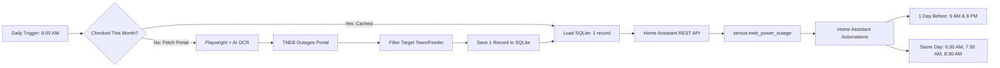

<div align="center">


# ⚡ TNEB Power Outage Checker & Home Assistant Sync

[](https://www.python.org/)
[](https://www.home-assistant.io/)
[](https://www.raspberrypi.com/)
[](https://www.sqlite.org/)
[](https://playwright.dev/)
[](LICENSE)

*Automated scheduled power shutdown monitor for Tamil Nadu Generation and Distribution Corporation (TNEB / TNPDCL). Features AI OCR captcha solving, smart monthly caching, Home Assistant synchronization, and multi-tier advance alerts.*

</div>

---

## 🌟 Highlights

- 🤖 **Fast AI Captcha Solver**: Uses `ddddocr` (ONNX) to recognize TNEB captchas in ~0.1s with near 100% accuracy. Zero external C++ binary dependencies.
- 📅 **Smart Monthly Caching**: Checks daily. Once the shutdown schedule for the current month is retrieved and stored, it **skips hitting the portal for the rest of that month**. If TNEB hasn't published the schedule early in the month, it continues checking daily until found.
- 💾 **Strict 1-Record-Per-Month Database**: Stores exactly one consolidated record per month in SQLite (`outages.db`). No database clutter.
- 🏠 **Native Home Assistant Integration**: Pushes state and rich attributes directly to `sensor.tneb_power_outage`. The outage schedule is retained in attributes throughout the entire month.
- ⏰ **Multi-Stage Advance Notifications**:
  - **1 Day Before**: Alerts at **9:00 AM** and **8:00 PM** (`"Tomorrow will be Power Shutdown from 09:00 - 14:00"`).
  - **Shutdown Day**: Reminders at **6:30 AM**, **7:30 AM**, and **8:30 AM** (`"Today will be Power Shutdown from 09:00 - 14:00"`).
- 🍓 **Optimized for Raspberry Pi 4 / 5**: Auto-detects system Chromium (`/usr/bin/chromium-browser`) and runs headless with low memory footprint (`--no-sandbox`, `--disable-dev-shm-usage`).

---

## 🏗️ Architecture Flow



---

## 🍓 Raspberry Pi 4 / Linux Setup Guide

Follow these steps to deploy and run the service on your Raspberry Pi 4:

### 1. Clone the Repository
```bash
git clone https://github.com/vijairathina/Power-Outage-Checker.git
cd Power-Outage-Checker
```

### 2. Install System Prerequisites
```bash
sudo apt update
sudo apt install -y python3-venv python3-pip chromium-browser
```

### 3. Create Virtual Environment & Install Dependencies
```bash
python3 -m venv venv
source venv/bin/activate
pip install -r requirements.txt
```

### 4. Configure Settings
Copy the template configuration:
```bash
cp config.example.json config.json
nano config.json
```

Update your Home Assistant URL, Long-Lived Access Token, and desired area filter:
```json
{
    "circle": "KRISHNAGIRI",
    "filter": "Hosur|Sanachandiram|Onnalvadi|Sanamavu|Thorapally|Karapaly|Kollapally|Thiruchipally|Old Temple Hudco|Alasanatham",
    "all_records": false,
    "daily_check_time": "06:00",
    "home_assistant": {
        "enabled": true,
        "url": "http://homeassistant.local:8123",
        "token": "YOUR_LONG_LIVED_ACCESS_TOKEN",
        "entity_id": "sensor.tneb_power_outage",
        "send_persistent_notification": false
    }
}
```

> **🔑 How to generate Home Assistant Token:**
> In your Home Assistant UI, click your **Profile icon** (bottom left) ➔ **Security** ➔ scroll to **Long-Lived Access Tokens** ➔ **Create Token**.

### 5. Test Run
```bash
python app.py
```
*(Verify output shows the outage record and `[Home Assistant] Successfully updated sensor.tneb_power_outage`)*

---

## ⏰ Running Automatically Daily at 6:00 AM on Raspberry Pi

Choose either **Method A (Cron - Simplest)** or **Method B (Systemd Service & Timer)**:

### 🔹 Method A: Linux Cron (Recommended)
Open crontab:
```bash
crontab -e
```
Add the following line to run every day at **6:00 AM**:
```cron
0 6 * * * cd /home/pi/Power-Outage-Checker && /home/pi/Power-Outage-Checker/venv/bin/python app.py >> /home/pi/Power-Outage-Checker/outage.log 2>&1
```
*(Adjust `/home/pi/Power-Outage-Checker` if your cloned folder is in a different directory)*

---

### 🔹 Method B: Systemd Timer & Service
Create the service unit:
```bash
sudo nano /etc/systemd/system/tneb-outage.service
```
Paste:
```ini
[Unit]
Description=TNEB Power Outage Checker
After=network-online.target
Wants=network-online.target

[Service]
Type=oneshot
User=pi
WorkingDirectory=/home/pi/Power-Outage-Checker
ExecStart=/home/pi/Power-Outage-Checker/venv/bin/python app.py
StandardOutput=journal
StandardError=journal

[Install]
WantedBy=multi-user.target
```

Create the timer to trigger daily at **6:00 AM**:
```bash
sudo nano /etc/systemd/system/tneb-outage.timer
```
Paste:
```ini
[Unit]
Description=Run TNEB Outage Checker daily at 6:00 AM

[Timer]
OnCalendar=*-*-* 06:00:00
Persistent=true

[Install]
WantedBy=timers.target
```

Enable and start the timer:
```bash
sudo systemctl daemon-reload
sudo systemctl enable --now tneb-outage.timer
```
Check timer status:
```bash
systemctl list-timers tneb-outage.timer
```

---

## 📱 Home Assistant Automation

The automation is provided in [`ha_automations.yaml`](ha_automations.yaml).

### How to Add in Home Assistant:
1. In Home Assistant, go to **Settings ➔ Automations & Scenes ➔ Create Automation**.
2. Click the top-right menu **(`⋮`)** ➔ **Edit in YAML**.
3. Paste the code below and click **Save**:

```yaml
alias: "TNEB Power Shutdown Notification Alert"
id: "tneb_power_shutdown_notification_alert"
description: "Sends notifications 1 day before (9 AM & 8 PM) and on the shutdown day (6:30 AM, 7:30 AM, 8:30 AM)"
mode: single

trigger:
  # 1 Day Before: 9:00 AM & 8:00 PM
  - platform: time
    at: "09:00:00"
    id: "day_before"
  - platform: time
    at: "20:00:00"
    id: "day_before"

  # Particular Day: 6:30 AM, 7:30 AM & 8:30 AM
  - platform: time
    at: "06:30:00"
    id: "same_day"
  - platform: time
    at: "07:30:00"
    id: "same_day"
  - platform: time
    at: "08:30:00"
    id: "same_day"

condition:
  - condition: template
    value_template: >
      {{ state_attr('sensor.tneb_power_outage', 'has_outage') == true and
         state_attr('sensor.tneb_power_outage', 'date') is not none }}

action:
  - choose:
      # 1. ONE DAY BEFORE (Tomorrow: 9:00 AM & 8:00 PM)
      - conditions:
          - condition: template
            value_template: >
              {{ state_attr('sensor.tneb_power_outage', 'date') == (now() + timedelta(days=1)).strftime('%Y-%m-%d') and
                 (trigger.id == 'day_before' or trigger.id is not defined) }}
        sequence:
          - service: persistent_notification.create
            data:
              title: "⚡ Power Shutdown Tomorrow"
              message: >
                Tomorrow will be Power Shutdown from {{ state_attr('sensor.tneb_power_outage', 'time') }}.
                Area: {{ state_attr('sensor.tneb_power_outage', 'town') }}
              notification_id: "tneb_shutdown_tomorrow"
          - service: notify.notify
            data:
              title: "⚡ Power Shutdown Tomorrow"
              message: >
                Tomorrow will be Power Shutdown from {{ state_attr('sensor.tneb_power_outage', 'time') }}. Area: {{ state_attr('sensor.tneb_power_outage', 'town') }}

      # 2. PARTICULAR DAY (Today: 6:30 AM, 7:30 AM & 8:30 AM)
      - conditions:
          - condition: template
            value_template: >
              {{ state_attr('sensor.tneb_power_outage', 'date') == now().strftime('%Y-%m-%d') and
                 (trigger.id == 'same_day' or trigger.id is not defined) }}
        sequence:
          - service: persistent_notification.create
            data:
              title: "⚡ Power Shutdown Today"
              message: >
                Today will be Power Shutdown from {{ state_attr('sensor.tneb_power_outage', 'time') }}.
                Area: {{ state_attr('sensor.tneb_power_outage', 'town') }}
              notification_id: "tneb_shutdown_today"
          - service: notify.notify
            data:
              title: "⚡ Power Shutdown Today"
              message: >
                Today will be Power Shutdown from {{ state_attr('sensor.tneb_power_outage', 'time') }}. Area: {{ state_attr('sensor.tneb_power_outage', 'town') }}
```

---

## 📊 Home Assistant Dashboard Card

Add this Markdown card to your Home Assistant dashboard:

```yaml
type: markdown
title: ⚡ Scheduled Power Outages
content: >
  {{ state_attr('sensor.tneb_power_outage', 'card_markdown') }}
```

---

## 💻 CLI Commands Reference

| Command | Description |
|---|---|
| `python app.py` | Run sync (uses monthly cache if already obtained) |
| `python app.py --force` | Force re-scrape from portal even if cached |
| `python app.py --history` | View stored history (strictly 1 record per month) |
| `python app.py --test-ha` | Test Home Assistant connection |
| `python app.py --daemon --time 06:00` | Run continuously as background daemon |
| `python app.py --circle "CHENNAI - CENTRAL"` | Query a different TNEB circle |

---

## 📄 License

This project is open-source and released under the [MIT License](LICENSE).
